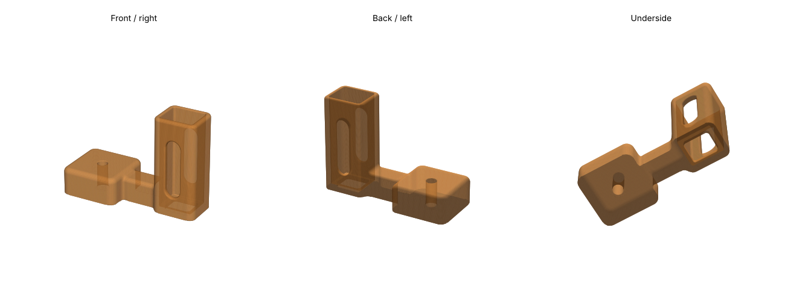
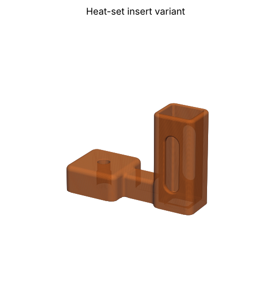

# NESDR tripod mount

A 3D-printable holder that puts a Nooelec NESDR SMArt v5 RTL-SDR stick on a camera tripod (1/4"-20 screw). The stick stands upright in a ventilated sleeve: USB plug down through the bottom lip into a USB extension cable, SMA connector and antenna on top. The sleeve sits 45 mm off the tripod screw, so the extension cable's socket hangs beside the tripod head.

## Variants

| File | Tripod screw goes into | Extra parts |
|---|---|---|
| `stl/nesdr-tripod-mount-selftap.stl` | A 5.4 mm hole the steel screw taps its own thread into | None |
| `stl/nesdr-tripod-mount-nut.stl` | A captive 1/4"-20 UNC hex nut slid in from the side of the foot | 1/4"-20 UNC nut (not M6: different pitch) |
| `stl/nesdr-tripod-mount-insert.stl` | A heat-set brass insert pressed in from below | 1/4"-20 UNC heat-set insert, 8 mm OD × 8 mm |

Self-tapping: thread the screw in slowly the first time and don't overtighten. It's fine for the ~40 g stick and whip; print the nut or insert version if the thread ever strips.

Insert: the pocket is 7.6 mm × 8.5 mm. Measure your insert's outer diameter first; the pocket should be OD − 0.4 mm. Press it in from below with a soldering iron (~240–250 °C for PETG) until flush, then hold a flat metal object on it for a few seconds so it sets square.

## Printing

- PETG, flat as exported (foot on the bed), no supports.
- 4 walls, 20–30 % infill.
- Overall size about 71 × 30 × 50 mm.

## Dimensions

- Stick: 59.1 × 16.9 × 14.2 mm, with 0.4 mm clearance per side.
- Sleeve: 2.4 mm walls, 50 mm tall, 2.4 mm bottom lip with a 13.4 × 11 mm opening for the USB plug.
- Vents: 8 mm stadium slots on both wide faces, z = 10–40 mm.
- Foot: 30 × 30 × 14 mm.

## Source

- `src/nesdr-tripod-mount.scad`: parametric OpenSCAD model. Set `mount = "selftap" | "nut" | "insert"` and adjust the clearances. Untested in OpenSCAD itself: check the render before printing.
- `src/smooth.py`: the script that generated the STLs (signed distance field + marching cubes; needs numpy and scikit-image). Run `python3 src/smooth.py selftap|nut|insert`.

